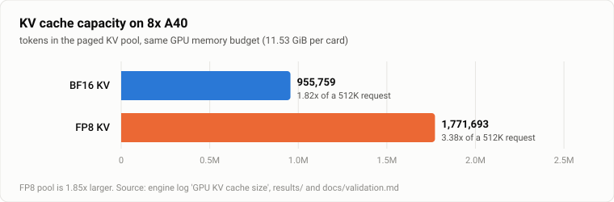
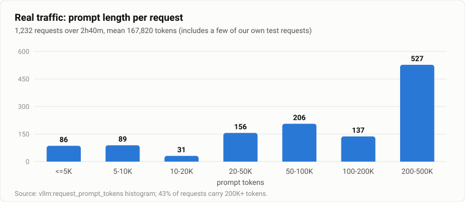
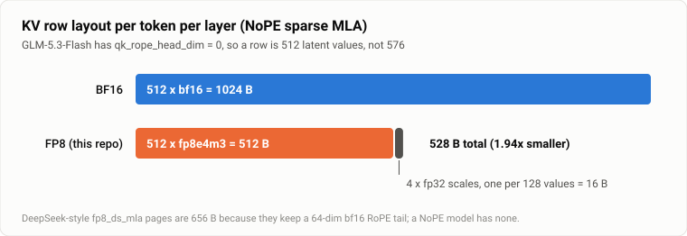
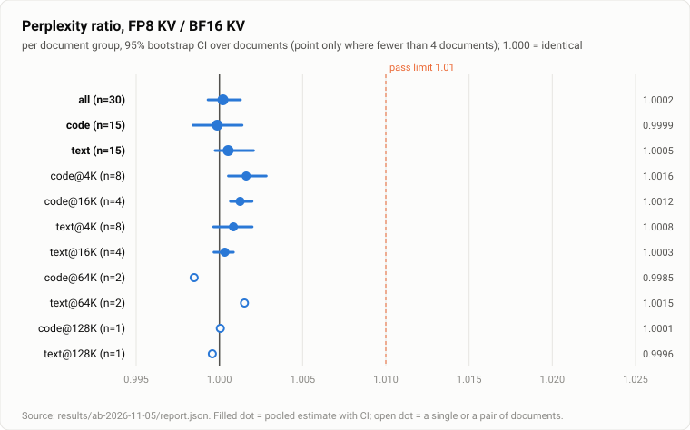
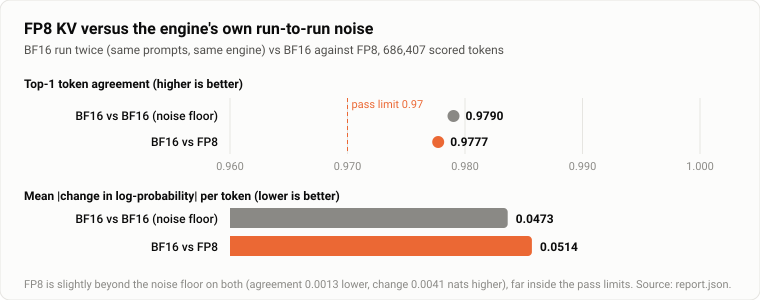

# glm53-flash-a40-fp8kv

**FP8 KV cache for NoPE sparse-MLA on Ampere (sm_86) — serving GLM-5.3-Flash on 8× A40.**

[](LICENSE)


[English](README.md) · [简体中文](README.zh-CN.md)

GLM-5.3-Flash is a 320B-parameter MoE with sparse MLA attention and **no RoPE tail** (`qk_rope_head_dim = 0`). On Ampere there is no sparse-MLA backend in mainline vLLM and no FP8 KV cache for the community Triton backend, so the KV pool is BF16-only. This repository adds a software-dequant **FP8 KV cache for the NoPE layout**, together with the tests, monitor and raw logs used to evaluate it on a shared production box.

> **Status: experimental.** The numbers below are real and reproducible from the logs in [`results/`](results), but several things are **not** verified — see [Limitations](#limitations) before relying on it.

## Highlights

- **1.85× larger KV pool** on the same memory: 955,759 → 1,771,693 tokens; concurrent 512K-token requests go from 1.82× to 3.38×.
- **528 B per token per layer** instead of 1024 B — a NoPE-specific page layout (the existing 656 B DeepSeek-style `fp8_ds_mla` page assumes a RoPE tail this model does not have).
- **Runs on sm_86**: decoding is bit-math inside the Triton kernel, so it never needs `fp8e4nv`, which does not exist below sm_89.
- **Same-prompt A/B against BF16 passes every pre-registered check**: perplexity ratio **1.0002** (95% CI 0.9993–1.0013) over 686,407 tokens of real code and English at 4K–128K; top-1 token agreement 0.9777 versus 0.9790 between two BF16 runs; MMLU (500 questions) 0.870 → 0.860, not significant (p = 0.23).
- **Needle retrieval 12/12** from 8K to 400K tokens on the FP8 cache; on an idle host single-stream decode is within about 2 % of BF16 (see Results).
- Ships with a **read-only canary monitor** and a **kernel/write-path test suite** (with negative controls that must fail).



## Why this matters

Real multi-user traffic on this deployment is long-context: of 1,232 requests, 527 carried 200K–500K tokens and the mean was 167,820 tokens. With a BF16 KV cache the pool reached 99.7 % utilisation and the prefix-cache hit rate collapsed to 1–7 % for about an hour, which stalled every user. After the switch to FP8 KV that did not recur in the roughly four hours observed since.



## How it works



| Part | What it does |
|---|---|
| Page layout | 512 × `fp8e4m3` + 4 × `fp32` per-128 scales = **528 B** per token per layer |
| Decode | Triton kernel loads the page as `uint8`, decodes e4m3 with integer bit-math (bit-exact against `torch.float8_e4m3fn` for all 256 byte values), applies the tile scale. MLA's V is the same row, so the decoded K tile is reused as V |
| Write | `torch` quantises per 128-wide tile (works on sm_86); a small Triton kernel scatters the 528 B pages into the paged cache and skips `slot < 0`. No host sync, so it is CUDA-graph capturable |
| Wiring | `TRITON_MLA_SPARSE` declares `fp8`/`fp8_e4m3`/`fp8_ds_mla`; quantised dtypes normalise to `fp8_ds_mla`; NoPE page size is 528 instead of 656; the base class's hard rejection of quantised KV becomes opt-in |

Details, including the failure modes we hit, are in [`docs/design.md`](docs/design.md).

## Results

Measured on 8× A40 (46 GB), TP8, MTP-3, prefix caching, 512K context.

**Capacity** (engine log `GPU KV cache size`)

| | BF16 KV | FP8 KV | ratio |
|---|---|---|---|
| Production configuration (`--gpu-memory-utilization 0.88`) | 955,759 tokens | **1,771,693 tokens** | 1.85× |
| 512K-request concurrency | 1.82× | **3.38×** | |
| Evaluation configuration (0.80, 2048-token chunks) | 728,108 tokens | 1,349,597 tokens | 1.853× |

**Speed, idle host, evaluation configuration, same image and only the cache flag changed** (`results/ab-2026-11-05/speed_*.txt`). Each benchmark was run twice in a row; in both configurations the second pass has **22–48 % higher aggregate throughput** at 2–8 streams (8 streams: 22–25 %) while single-stream decode is unchanged. The most likely cause is kernel JIT and prefix-cache hits (not isolated), so only numbers from the same pass are comparable.

| | pass | BF16 KV | FP8 KV | FP8 / BF16 |
|---|---|---|---|---|
| Single stream, mean of 3 long outputs (tok/s) | 1 · cold | 110.8 | 108.7 | 0.98 |
| | 2 · warm | 109.6 | 107.1 | 0.98 |
| 4 streams, aggregate (tok/s) | 1 · cold | 217 | 212 | 0.98 |
| | 2 · warm | 297 | 285 | 0.96 |
| 8 streams, aggregate (tok/s) | 1 · cold | 302 | 295 | 0.98 |
| | 2 · warm | 367 | 368 | 1.00 |

FP8 is at most about 6 % slower in any cell (2 streams, warm: 198 vs 186), with one measurement per cell, so a difference of a few percent is not resolved.

**Accuracy on the FP8 instance**

| | |
|---|---|
| Needle retrieval, 8K–400K × 3 depths | **12 / 12** |
| Arithmetic / format / code (chat endpoint) | 12/12 · 3/3 · 3/3 |
| Attention-output error (synthetic data) | 1.3–3.2 % rel., cos 0.9995–0.9999 |

### Same-prompt A/B against BF16

Both arms ran the same image; the only difference was `--kv-cache-dtype auto` versus `fp8_ds_mla` (protocol and pass criteria, fixed beforehand: [`docs/ab-protocol.md`](docs/ab-protocol.md)). 30 documents (real Python source and technical English, 4K–128K tokens, 686,407 scored tokens), 40 greedy continuations, 500 MMLU questions. The BF16 arm was run twice to measure the engine's own run-to-run noise.

| Metric | BF16 vs FP8 | BF16 vs BF16 (noise floor) | Pre-registered limit |
|---|---|---|---|
| Perplexity ratio, all (code · text) | **1.0002** (0.9999 · 1.0005) | 0.9997 | ≤ 1.01 |
| 95% CI upper end | 1.0013 | | ≤ 1.02 |
| Top-1 token agreement | 0.9777 | 0.9790 | ≥ 0.97, and within 0.02 of the floor |
| Mean absolute change in log-probability | 0.0514 | 0.0473 | reported |
| MMLU accuracy (500) | 0.870 → 0.860; lost 8 / gained 3, p = 0.23 | | drop ≤ 0.03 |
| **Verdict** | **PASS (14 of 14 checks)** | | |





How to read this:

- The pooled perplexity ratio is within about 0.1 % of 1.000 with a tight interval: averaged over this corpus, FP8 KV does not measurably change next-token likelihood.
- **The engine is noisy against itself.** Two BF16 runs on identical prompts disagree on the argmax token at 2.1 % of positions and move the log-probability by 0.047 nats on average. FP8 sits just beyond that floor (agreement 0.0013 lower, change 0.0041 nats higher). So the test cannot resolve effects smaller than that run-to-run variation at the token level, and says nothing about them.
- Two length groups have intervals just above 1.000 (code at 4K: 1.0016, code at 16K: 1.0012). They are not pass/fail rows, and with eleven groups we cannot tell a real +0.1 % from chance.
- Greedy continuations are not informative: only 10 % are identical across BF16 and FP8, and also only 10 % across two BF16 runs (median first divergence at token 32 vs 47).
- Not controlled: the second BF16 greedy run reused the prefix cache from the first (same prompts); `prompt_logprobs` requests recompute the whole prompt, so perplexity was unaffected.

Raw per-token data (gzip) and the report are in [`results/ab-2026-11-05`](results/ab-2026-11-05).

## Quick start

> Requires `lazymio/vllm-backport:v0.13.1-sm86` and `wtdcode/GLM-5.3-Flash-AWQ-W4A16`. Verified against that exact image only.

**A. Docker image (recommended).** The two diffs are applied at build time; the build fails if either does not apply or a marker is missing, and the entrypoint refuses to start a half-patched tree.

```bash
DOCKER_BUILDKIT=0 docker build -f docker/Dockerfile -t glm53-fp8kv:v0.13.1-sm86 .   # legacy builder = uses the local base image
docker run --gpus all --ipc=host -p 8000:8000 -v /path/to/GLM-5.3-Flash-AWQ-W4A16:/model:ro \
  glm53-fp8kv:v0.13.1-sm86 /model --tensor-parallel-size 8 --kv-cache-dtype fp8_ds_mla \
  --served-model-name glm-5.3-flash --max-model-len 524288 --enable-prefix-caching \
  --disable-custom-all-reduce --reasoning-parser glm45 --tool-call-parser glm47 --enable-auto-tool-choice
```

**B. Patch an existing installation** (backs up first, dry-runs on a scratch copy, can be reverted):

```bash
scripts/apply_patches.sh /usr/local/lib/python3.12/dist-packages --dry-run
scripts/apply_patches.sh /usr/local/lib/python3.12/dist-packages
scripts/apply_patches.sh /usr/local/lib/python3.12/dist-packages --revert
```

**C. Our host** (no nvidia-container-toolkit, devices and driver libraries passed by hand): `scripts/launch_host_a40.sh`.

**Tests** (need a GPU; they cap their own memory):

```bash
python3 tests/test_fp8kv_kernel.py
python3 tests/test_fp8kv_write.py
```

**Packaging status.** The `docker run` line above is an example; our host passes devices by hand instead of `--gpus all`. Checked without a GPU: the diffs reproduce the deployed files byte for byte from the pristine image; the image builds; the entrypoint guard rejects a deliberately broken image (exit 78). **Checked on 8× A40:** the built image started in both cache modes and ran the A/B evaluation above, and it now serves production. See [`docs/validation.md`](docs/validation.md).

## Limitations

1. **The BF16 comparison covers one model, one GPU type, one corpus family.** The documents are real code and technical English, not agent transcripts; MMLU with 500 questions cannot resolve a one-point change.
2. **The noise floor is high** (see above), so small token-level effects are not resolvable. The aggregate perplexity interval is tight, the per-position comparison is not.
3. **The evaluation configuration differs from production** (`--gpu-memory-utilization 0.80`, 2048-token chunks, so that `prompt_logprobs` fits in memory); production uses 0.88 and 8192. The FP8 candidate was run once.
4. **Kernel error was also measured on synthetic Gaussian data** (1.3–3.2 %); the A/B above is the real-text evidence. Error accumulation in very long agent sessions is not covered.
5. **The canary cannot see long-session degeneration** (e.g. wtdcode/vllm-backport#119). It found 0 wrong or cross-contaminated answers in 79 runs, but it only sends short probes.
6. **The abort-and-retry stress test does not discriminate**: 0/36 failures both without and with the patch set, and the baseline ran with MTP off.
7. The quantise step is torch ops plus a Triton scatter, not a fused kernel; the idle-host speed table shows FP8 within about 6 % of BF16 end to end, but its own cost was not isolated.
8. Image requests were not tested. The MTP draft model does not consume vision embeddings (engine warning).

## Repository layout

```
patches/    fp8kv_wiring.diff (this work) · patched_tree.diff (deployed 5-file set vs v0.13.1)
docker/     Dockerfile + entrypoint (build-time patching, start-up marker guard)
scripts/    apply_patches.sh, verify_markers.sh, launch_host_a40.sh, run_ab_window.sh, warmup.py, dry-run and porting helpers
tests/      kernel and write-path tests, accuracy suites, needle-in-haystack, stress, metrics summary, ab_eval.py (A/B harness)
monitor/    glm_monitor.py — read-only health + two-way concurrent canary (cron, every 5 min)
results/    raw logs behind every number above; ab-2026-11-05/ holds the A/B report and per-token data
docs/       design.md · validation.md · ab-protocol.md · figures
```

## Related work and credits

- [nickus/vllm-fp8kv](https://github.com/nickus/vllm-fp8kv) (Apache-2.0) — the software-dequant FP8 approach and the bit-exact decoder this work adapts to the NoPE layout.
- [wtdcode/vllm-backport](https://github.com/wtdcode/vllm-backport) — the Ampere image and GLM-5.3-Flash support this runs on.
- vLLM [#56524](https://github.com/vllm-project/vllm/pull/56524) / [#56525](https://github.com/vllm-project/vllm/pull/56525) (datacrystals) and the patch list posted by ehrhart in wtdcode/vllm-backport#119 — used for the patched set. `patches/patched_tree.diff` contains the **net effect** of #56525 and a hand-port of #56524 against v0.13.1 (vLLM is Apache-2.0; the authors are credited here). The other PRs from that list were only dry-run, not applied, and are not included.
- vLLM RFCs [#48374](https://github.com/vllm-project/vllm/issues/48374) and [#59016](https://github.com/vllm-project/vllm/issues/59016) — the upstream discussion of FP8 KV on Ampere sparse MLA.

## Maintainer

Created and maintained by **[SheridanLu](https://github.com/SheridanLu)**, who set the objectives, owned the deployment and release decisions on shared production hardware, and required that every claim be backed by a raw log.

*AI assistance:* the code, tests and documentation were written with Claude Code (Anthropic) under the maintainer's direction. All experiments ran on the maintainer's hardware. Please review the code accordingly.

## License

Apache-2.0 (derivative of vLLM). See [LICENSE](LICENSE) and [NOTICE](NOTICE). Provided without warranty.
