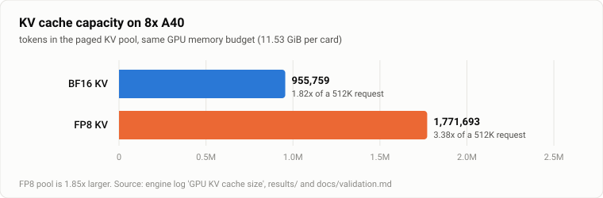
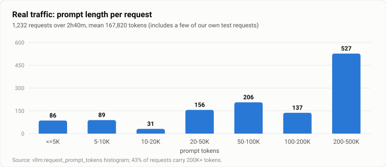
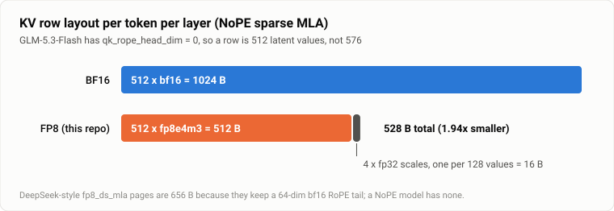

# glm53-flash-a40-fp8kv

**Ampere(sm_86)上 NoPE 稀疏 MLA 的 FP8 KV 缓存 —— 在 8× A40 上部署 GLM-5.3-Flash。**

[English](README.md) · 简体中文

GLM-5.3-Flash 是 320B 参数的 MoE,使用稀疏 MLA 注意力,且**没有 RoPE 尾部**(`qk_rope_head_dim = 0`)。在 Ampere 上,主线 vLLM 没有稀疏 MLA 后端,社区的 Triton 后端也没有 FP8 KV,KV 池只能用 BF16。本仓库为 **NoPE 布局**实现了软件反量化的 **FP8 KV 缓存**,并附上在共享生产机上评估它所用的测试、监视器和原始日志。

> **状态:实验性。** 下面的数字真实,可由 [`results/`](results) 里的日志复核;但有若干项**没有验证**,使用前请先读[局限](#局限)。

## 要点

- **同样的显存,KV 池大 1.85 倍**:955,759 → 1,771,693 tokens;512K 长度请求的并发上限从 1.82 倍提高到 3.38 倍。
- **每 token 每层 528 字节**,原来是 1024 字节 —— 这是针对 NoPE 的页布局(现有 656 字节的 DeepSeek 式 `fp8_ds_mla` 页假设有 RoPE 尾部,本模型没有)。
- **能在 sm_86 上跑**:解码用 Triton 内核里的整数位运算,不需要 sm_89 以下不存在的 `fp8e4nv`。
- FP8 缓存上**针检索 12/12**(8K 到 400K tokens);单流速度在测量噪声内不变(107–110 tok/s)。
- 附**只读金丝雀监视器**和**内核/写入路径测试**(带必须失败的阴性对照)。



## 为什么重要

这套部署的真实多人流量是长上下文:1,232 个请求里 527 个带 20 万~50 万 tokens,平均 167,820 tokens。BF16 KV 时池使用率到过 99.7%,前缀缓存命中率约一小时内掉到 1%~7%,所有人一起卡。改用 FP8 KV 后的大约四小时观察里没有再出现。



## 原理



| 部分 | 做法 |
|---|---|
| 页布局 | 512 × `fp8e4m3` + 4 × `fp32`(每 128 个值一个缩放)= **528 B**/token/层 |
| 解码 | Triton 内核按 `uint8` 读页,用整数位运算解 e4m3(对 256 个字节值与 `torch.float8_e4m3fn` 逐位一致),再乘分块缩放。MLA 的 V 就是同一行,解码后的 K 直接复用做 V |
| 写入 | `torch` 按 128 宽分块量化(sm_86 上可用);小 Triton 内核把 528 B 页散写进分页缓存,`slot < 0` 跳过;无主机同步,可被 CUDA graph 捕获 |
| 接线 | `TRITON_MLA_SPARSE` 声明 `fp8`/`fp8_e4m3`/`fp8_ds_mla`;量化 dtype 规范化为 `fp8_ds_mla`;NoPE 页大小 528 而非 656;基类对量化 KV 的硬性拒绝改为可选择开启 |

细节和我们踩过的坑见 [`docs/design.md`](docs/design.md)。

## 结果

8× A40(46 GB),TP8,MTP-3,前缀缓存,512K 上下文,`--gpu-memory-utilization 0.88`,2026-11-04。

| | BF16 KV | FP8 KV |
|---|---|---|
| KV 池 | 955,759 tokens | **1,771,693 tokens** |
| 512K 请求并发 | 1.82× | **3.38×** |
| 单流 | 85–124 tok/s(均值约 107) | 107–110 tok/s |
| 8 路合计 | 259 tok/s | 289 tok/s ¹ |
| 针检索,8K–400K × 3 个深度 | — | **12 / 12** |
| 算术 / 格式 / 代码(聊天接口) | — | 12/12 · 3/3 · 3/3 |
| 注意力输出误差(合成数据) | — | 相对 1.3–3.2%,余弦 0.9995–0.9999 |

¹ 两次测量的背景负载不同;±12% 以内的差别不应解读为提速。

完整方法、原始数字及出处文件:[`docs/validation.md`](docs/validation.md)。

## 快速开始

> 需要 `lazymio/vllm-backport:v0.13.1-sm86` 镜像和 `wtdcode/GLM-5.3-Flash-AWQ-W4A16`。脚本里的路径(`/data/glm_test/...`)是我们机器上的,请自行替换。

```bash
# 1. 取出容器里 vllm 的 *.py 作为基线,然后应用
git apply patches/patched_tree.diff      # #56525 + #56524 的手工移植(见 docs/design.md)
git apply patches/fp8kv_wiring.diff      # 本仓库的 FP8 KV 改动(4 个文件)

# 2. 把改过的文件只读挂载覆盖容器里的包,并加上
#       --kv-cache-dtype fp8_ds_mla
bash scripts/run_glm_fp8kv.sh            # 校验 5 个标记,引擎起不来会自动回退

# 3. 测试(需要 GPU;脚本自带显存上限)
python3 tests/test_fp8kv_kernel.py
python3 tests/test_fp8kv_write.py
```

## 局限

1. **没有在真实文本上做同题的 BF16 与 FP8 对照**(困惑度或 logit 差)。精度数字是简单题集上的绝对通过率,BF16 大概也能满分,量不出 FP8 的代价。
2. **内核误差是在合成高斯数据上测的。** 真实潜向量、11 个稀疏层的误差累积、INT4 权重叠加 FP8 KV,都没测。
3. **金丝雀看不到长会话退化**(如 wtdcode/vllm-backport#119)。79 次运行中 0 次答错或串内容,但它只发短探针。
4. **取消重试压力测试不具判别力**:未打补丁与打补丁后都是 0/36,且基线是 MTP 关闭。
5. 量化步骤是 torch 算子加 Triton 散写,不是融合内核,端到端开销没单独测。
6. 速度数据来自不同背景负载的两次测量(见上表脚注)。
7. 没测图像请求。MTP 草稿模型不接收视觉嵌入(引擎有警告)。

## 目录

```
patches/    fp8kv_wiring.diff(本工作) · patched_tree.diff(线上 5 个文件相对 v0.13.1 的改动)
scripts/    启动与自动回退、补丁干跑、移植辅助
tests/      内核与写入路径测试、精度套件、针检索、压力测试、指标汇总
monitor/    glm_monitor.py —— 只读健康检查 + 两路并发金丝雀(cron 每 5 分钟)
results/    上面每个数字背后的原始日志
docs/       design.md · validation.md · 图
```

## 相关工作与致谢

- [nickus/vllm-fp8kv](https://github.com/nickus/vllm-fp8kv)(Apache-2.0)—— 软件反量化 FP8 的思路与逐位一致的解码器,本工作将其改写为 NoPE 布局。
- [wtdcode/vllm-backport](https://github.com/wtdcode/vllm-backport) —— 本工作运行所基于的 Ampere 镜像与 GLM-5.3-Flash 支持。
- vLLM [#56524](https://github.com/vllm-project/vllm/pull/56524) / [#56525](https://github.com/vllm-project/vllm/pull/56525)(datacrystals),以及 ehrhart 在 wtdcode/vllm-backport#119 中给出的补丁清单 —— 用于补丁集。`patches/patched_tree.diff` 包含 #56525 的**净改动**和对 #56524 的手工移植(针对 v0.13.1;vLLM 为 Apache-2.0,作者在此署名);该清单里的其余 PR 只做了干跑,没有应用,也不在本仓库中。
- vLLM RFC [#48374](https://github.com/vllm-project/vllm/issues/48374)、[#59016](https://github.com/vllm-project/vllm/issues/59016) —— 上游关于 Ampere 稀疏 MLA FP8 KV 的讨论。

## 维护者

由 **[SheridanLu](https://github.com/SheridanLu)** 创建并维护:设定目标,对共享生产硬件上的部署与发布决策负责,并要求每一条结论都有原始日志支撑。

*AI 协助说明:* 代码、测试与文档在维护者指导下由 Claude Code(Anthropic)协助完成,所有实验均在维护者的硬件上运行,请据此审阅代码。

## 许可

Apache-2.0(vLLM 衍生),见 [LICENSE](LICENSE) 与 [NOTICE](NOTICE)。不提供任何担保。
